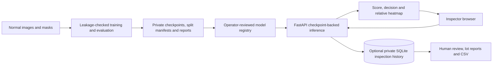

# IhsanVision.AI

**Industrial visual anomaly detection — from reproducible ML experiments to an operator-facing application.**

[](https://github.com/naim-munshi/ihsanvision-ai-industrial-anomaly-detection/actions/workflows/ci.yml)

**Stack:** Python · PyTorch · Anomalib 2.5.0 · PaDiM · PatchCore · FastAPI · SQLite · Docker · GitHub Actions

> **Status:** AI engineering portfolio prototype, **not a production-certified defect detection system**. PaDiM and PatchCore have measured results on **MVTec AD / bottle** and working local checkpoint-backed inference. The fixed [portfolio v1.0 scope and evidence gates](docs/portfolio-v1-plan.md) additionally require cable/carpet evaluation, integrated runtime testing, real checkpoint-backed Docker acceptance, approved demo media and a reviewed release. No further categories or enterprise features are required for v1.0.

## Explore the project

| For recruiters | For developers |
| --- | --- |
| [Measured results](#measured-model-performance--mvtec-ad-bottle) and [observed serving speed](#real-local-serving-evidence) | [Local demo setup](#reproduce-the-application-locally) |
| [Architecture](#software-architecture) and [model limitations](docs/model-card.md) | [Training and 3-category comparison](#reproduce-the-experiments) |
| [What was actually tested](#what-is-implemented-vs-independently-validated) | [Automated tests](#tests-and-engineering-practices) and [Docker guide](docs/container-deployment.md) |
| [Final demo plan](docs/portfolio-demo-storyboard.md) *(media pending)* | [Owner finishing steps](FINISHING.md) and [fixed P1–P10 gates](docs/portfolio-v1-plan.md) |

**Demo status:** This repository does not yet publish a video, production deployment, trained checkpoints or redistribution-licensed dataset screenshots. Historical Kaggle/Mac results and Linux Docker CI evidence are linked below.

## Project in 30 seconds

IhsanVision.AI applies **normal-only visual anomaly detection** to manufactured products. The operator submits an image or a small batch, chooses a locally trusted category-specific model, and receives an **uncalibrated anomaly score**, an optional normal/anomaly decision and a **relative localization heatmap**. Optional private workflows track production lots, human reviews, model checkpoint versions and metadata-only CSV reports.

**Engineering problems addressed:** training/evaluation leakage prevention, fair PaDiM–PatchCore comparison, checkpoint-backed model serving, bounded request admission, private inspection traceability and reproducible performance measurement. [System design](docs/architecture.md) · [Model card](docs/model-card.md) · [Evaluation protocol](docs/evaluation.md).

### Measured model performance — MVTec AD bottle

| Held-out metric | PaDiM | PatchCore |
| --- | ---: | ---: |
| Image AUROC | 0.9963 | 1.0000 |
| Image F1 | 0.9592 | 0.9901 |
| Pixel AUROC | 0.9768 | 0.9857 |
| Pixel F1 | 0.6497 | 0.7102 |

**Protocol:** one category, seed 42; 209 normal training images; 16 images held out for validation from the MVTec test folder; 67 remaining test images. The models share recorded train/validation/test image **paths**. These scores are **not directly comparable to published full-test MVTec AD benchmarks**; PatchCore's 1.0000 image AUROC does not imply perfect real-world defect detection. Per-image color heatmaps are visual explanations, not calibrated defect masks.

Evidence: [PaDiM Kaggle experiment](reports/2026-10-13-kaggle-padim-bottle.md) · [PatchCore Kaggle experiment and archive](reports/2026-10-15-kaggle-patchcore-bottle.md) · [Evaluation methodology](docs/evaluation.md).

### Real local serving evidence

| Observation | PaDiM | PatchCore |
| --- | ---: | ---: |
| HTTP p50, warm sequential (ms) | 388.87 | 493.05 |
| HTTP p95, warm sequential (ms) | 766.46 | 514.82 |
| Requests in paired profiles | 20 | 20 |
| Cached model reuse in measured requests | 20/20 | 20/20 |

The paired Mac experiments used the same transmitted 900×900 PNG, three warmups and 20 sequential measured requests per model. These are **small observed profiles**, not load capacity or performance guarantees. A four-request Mac API check also verified expected normal/defective labels and valid overlays for both models. [Serving profile](reports/2026-10-16-macos-paired-serving-profile.md) · [Real dual-model acceptance](reports/2026-10-16-macos-dual-model-api-acceptance.md).

## Software architecture



Training and public application hosting are **separate concerns**. Dataset images, model weights and private operator data are intentionally excluded from Git. The local server loads only operator-configured checkpoints; raw anomaly scores are **not probabilities**. [Architecture and component contracts](docs/architecture.md).

## What is implemented vs independently validated?

| Capability | Evidence status |
| --- | --- |
| Bottle PaDiM/PatchCore training, evaluation, saved weights | **Observed real Kaggle runs; Mac archive SHA-256 checks** |
| Local model routing, image inference, heatmaps | **Real Mac browser/API evidence** |
| Model-cache reuse, sequential latency | **Real Mac paired profiles; limited workload** |
| Batch dashboard, CSV, lot history and independent human review | **Code and offline/mock integration tests; latest Mac E2E pending** |
| Private checkpoint pins, staged model releases, local API security | **Offline regression tested; latest real-model verification pending** |
| Linux CPU Docker image + local Compose | **Real Linux build, API smoke, PaDiM/PatchCore initialization and package check passed in CI; target Mac checkpoint-backed Docker inference pending** |
| Cable and carpet paired experiments | **Not yet executed; no fabricated metrics** |
| Release media, legal approval and versioned v1.0 tag | **Responsible-use source license added; media rights/legal review and v1.0 release pending** |

The baseline GitHub Actions checks run lightweight Python 3.11/3.12, dashboard JS, source hygiene and static Compose tests. Separately, an [actual Linux CPU Docker run](https://github.com/naim-munshi/ihsanvision-ai-industrial-anomaly-detection/actions/runs/39100705980) passed container build, HTTP startup, PyTorch/Anomalib imports, both model-class initialization and installed-package compatibility checks. **Neither CI path executes checkpoint-backed PaDiM/PatchCore inference**. [Latest CI](https://github.com/naim-munshi/ihsanvision-ai-industrial-anomaly-detection/actions/workflows/ci.yml).

## Reproduce the application locally

**Requirements:** Python 3.11–3.13, an appropriate PyTorch installation, sufficient memory and **your own trusted saved checkpoint files**. MVTec data and checkpoints are not distributed through this repository.

```bash
git clone https://github.com/naim-munshi/ihsanvision-ai-industrial-anomaly-detection.git
cd ihsanvision-ai-industrial-anomaly-detection
python3 -m venv .venv
source .venv/bin/activate
python -m pip install -r requirements.txt
python -m pip install -e . --no-deps
```

Place both Bottle checkpoints from a run you trust in a **private** folder with this structure:

```text
~/ihsanvision-artifacts/benchmark-bottle-seed42-2026-10-15/
  padim-bottle-seed42/model.ckpt
  patchcore-bottle-seed42/model.ckpt
```

Then launch the local-only demo:

```bash
python -m scripts.run_local_demo
```

Open **http://127.0.0.1:8003/** for individual predictions, **/batch** for multi-image inspection and **/history** for optional private human review. Optional operator-key/history setup: [private inspection guide](docs/private-inspection-history.md). Keep this prototype bound to localhost; never deserialize untrusted Lightning checkpoints.

To collect reproducible **real checkpoint-backed acceptance evidence** on the Mac with both models running, use two privately held, independently labeled Bottle samples (separate terminal):

```bash
python -m scripts.local_stack_acceptance \
  --url http://127.0.0.1:8003 \
  --normal /absolute/private/normal_bottle.png \
  --defective /absolute/private/defective_bottle.png \
  --output "$HOME/ihsanvision-artifacts/local-stack-acceptance.json"
```

Add `--require-auth` and configure `IHSANVISION_CLIENT_API_KEY` privately when server-side authentication is enabled. Successful code-level tests **do not** stand in for this real acceptance run. [Full steps](docs/operational-acceptance.md) · [Docker instructions and acceptance gates](docs/container-deployment.md).

## Reproduce the experiments

The [resumable classic MVTec AD runner](docs/resumable-multicategory-training.md) plans missing model/category pairs without retraining completed work. It validates saved reports and exact paired split paths. **Dry-run by default**:

```bash
python -m scripts.resume_mvtec_training \
  --dataset-root /absolute/private/MVTecAD \
  --runs-dir /absolute/private/ihsanvision_runs \
  --categories bottle cable carpet --seed 42
```

Execute missing work **only on your own licensed dataset and compute environment**, with `--execute --max-jobs 1`, after reviewing the dry-run. Once all six checkpoint/report/split trios genuinely exist, build the **read-only** 3-category comparison (no fitting or metrics fabrication):

```bash
python -m scripts.summarize_comparison \
  --runs-dir /absolute/private/ihsanvision_runs \
  --from-saved-runs --categories bottle cable carpet --seed 42
```

Preserve the existing completed Bottle artifacts rather than retraining them. [Model comparison and evidence verification](docs/verified-benchmark-summary.md) · [False-positive/false-negative audit](docs/portfolio-error-analysis.md). The optional MVTec AD 2 research adapter is **out of scope for portfolio v1.0**.

## Tests and engineering practices

```bash
python -m pip install -r requirements-dev.txt
python -m pip install -e . --no-deps
python -m pytest -q
node --test tests/*.test.cjs
```

Development and deployment details: [developer guide](docs/development.md) · [container guide](docs/container-deployment.md) · [security baseline](docs/security-baseline.md) · [model registration and review](docs/operator-model-releases.md).

## Finish the job-ready portfolio

**Owner handoff:** [FINISHING.md](FINISHING.md) consolidates the exact four
remaining model jobs, final local Mac/Docker commands, evidence and release
steps. [Demo storyboard](docs/portfolio-demo-storyboard.md) defines the
rights-cleared screenshots and 90-second actual software recording.
[Unreleased changelog](CHANGELOG.md) distinguishes implemented code from
pending experiments and real runtime acceptance.
[Source release hygiene](docs/release-source-hygiene.md) audits the current
Git-tracked files. A separate [actual historical Git object audit](reports/2026-10-19-git-history-audit.md)
checked reachable past commits for a limited set of secrets and restricted assets;
neither scan proves complete security, legal rights or release authorization.

## Portfolio release gates

The immutable [portfolio v1.0 plan](docs/portfolio-v1-plan.md) defines observable acceptance evidence for the remaining work:

1. Reproduce or independently audit the preserved Bottle experiment artifacts.
2. Finish the **four missing** paired experiments on cable/carpet (PaDiM and PatchCore for each).
3. Run the latest complete application flow using real checkpoints; verify real target-hardware Docker build and checkpoint-backed inference.
4. Publish **only approved/original demo visuals**, a concise walkthrough, honest benchmark and error-case analysis.
5. Review the responsible-use license, external dataset/media rights and documentation; create a versioned GitHub release only after all gates pass.

**Not required:** all 15 categories, MVTec AD 2, Kubernetes, cloud multi-tenancy, physical conveyor integration or commercial factory certification. No public hosted demo or v1.0 release is claimed today.

## Responsible use and legal scope

The original project source code is available under the [IhsanVision.AI Responsible Use License v1.0](LICENSE): study, modify and share it for lawful, non-harmful purposes **only**. Harmful use is prohibited. This is a **source-available, use-restricted license, not an OSI-approved open-source license**. See [licensing and permitted uses](docs/licensing.md). This license **does not cover MVTec AD/AD2 datasets, pretrained weights or other third-party assets**; MVTec explicitly prohibits commercial dataset use without separate permission. Review rights before publishing images, checkpoints or a demo video.

**IhsanVision.AI is a normal-only, unsupervised anomaly-detection research and portfolio tool** (defect labels are used for held-out evaluation, not normal-image training). It is not a replacement for validated manufacturing quality assurance or safety-critical decisions.
